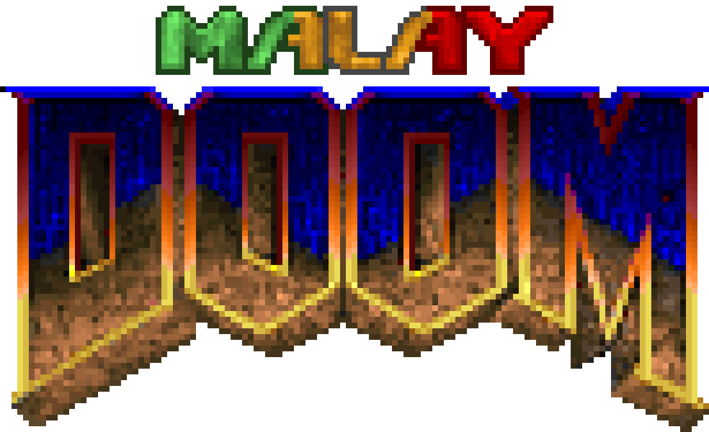

# MalayDoom

**Projek terjemahan bahasa Melayu untuk Classic Doom. Inilah Doom, tapi dalam Bahasa Melayu!**

MalayDoom ialah projek peminat tidak rasmi yang menterjemahkan Classic Doom dan keluaran berkaitannya ke dalam bahasa Melayu.

> **Projek ini tidak mempunyai sebarang kaitan dengan, tajaan daripada, atau sokongan rasmi daripada id Software atau Bethesda.**

> *Revision pertama projek ini akan diterbitkan pada 28hb Oktober ini.*

## Permainan yang Disokong

MalayDoom Revision 1 akan menyediakan WAD penterjemahan untuk permainan berikut:

- The Ultimate Doom

- Doom II

- Final Doom (TNT: Evilution dan The Plutonia Experiment)

- Master Levels for Doom II (versi PSN dan KEX)

- No Rest for the Living

- SIGIL dan SIGIL II

- Legacy of Rust

Master Levels mempunyai WAD berasingan untuk versi PSN dan KEX kerana kedua-dua keluaran tersebut menggunakan susunan peta yang berbeza.

## Muat Turun

Muat turun terbitan terkini melalui [**GitHub Releases**](https://github.com/NuruTheDoomer/MalayDoom/releases).

Arkib keluaran lengkap mengandungi WAD terjemahan, dokumentasi dan fail lain yang berkaitan. WAD individu dan addon keserasian pilihan turut disediakan jika berkenaan.

Satu edaran berasingan yang serasi dengan DOS turut disediakan untuk permainan yang disokong, bagi kegunaan dengan source port DOS yang serasi seperti Boom dan MBF.

## Keserasian

MalayDoom menyokong pelbagai source port Doom, tetapi tahap keserasiannya berbeza mengikut source port dan versinya.

Lihat [COMPATIBILITY.md](https://chatgpt.com/c/COMPATIBILITY.md) untuk maklumat lanjut.

## Tangkapan Layar

Lihat [SHOWCASE.md](https://chatgpt.com/c/SHOWCASE.md) untuk tangkapan layar MalayDoom dalam permainan. Jika anda ingin melihat tangkapan skrin lama daripada proses pembangunan projek ini, ia boleh dilihat [di sini](assets/screenshots/history/README.md)!

## History

Berminat dengan sejarah MalayDoom dan bagaimana ia bermula? Lihat [HISTORY.md](HISTORY.md)!

## Dokumentasi

- [Log Perubahan](https://chatgpt.com/c/CHANGELOG.md)

- [Keserasian](https://chatgpt.com/c/COMPATIBILITY.md)

- [Sumbangan](https://chatgpt.com/c/CONTRIBUTING.md)

- [Penghargaan](https://chatgpt.com/c/CREDITS.md)

- [Sejarah](https://chatgpt.com/c/HISTORY.md)

- [Keizinan](https://chatgpt.com/c/PERMISSIONS.md)

- [Istilah](https://chatgpt.com/c/TERMINOLOGY.md)

- [Senarai Tugas](TODO.md)
