# Historical Screenshots

These are the screenshots taken throughout the early days of MalayDoom's development. They may showcase older translations that are no longer in use.

---

Dated 30th July 2021. This is a screenshot I sent to a friend during the pandemic. The last obituary roughly translates to: "NuruddinPlaysDOOM got too close to a cacodemon. Follow the SOP next time! :v" (yes, this is before I have a separate Doom name) 
Basically an earlier translation of the obituary back when I made this project with GZDoom in mind, and way before Woof! added support for them. The only added part is the [SOP](https://en.wikipedia.org/wiki/Standard_operating_procedure) message, which is especially relevant back then iykyk.

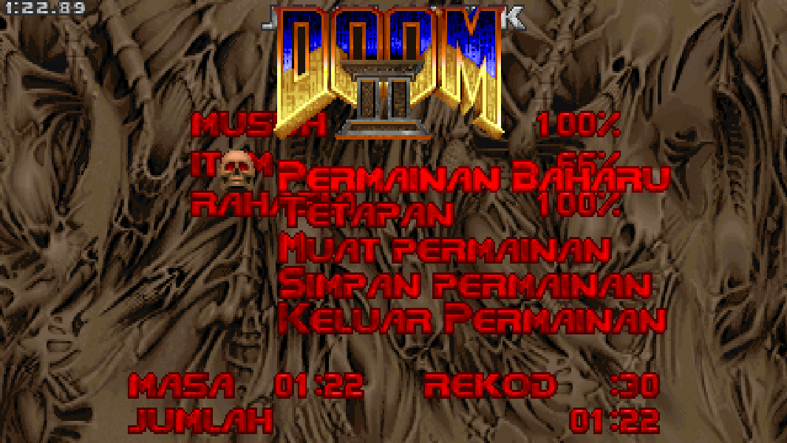

Dated somewhere before or around 12th October 2024. These screenshots showcase the old translation for New/Load/Save Game menus. The "Permainan" part is now replaced with "Game" so that the menu graphics would fit in 4:3 space without needing to do some sort of manual graphic offsetting. This screenshot also showcase the total time that got pushed to the right due to the "Jumlah" translation graphic being too long. 

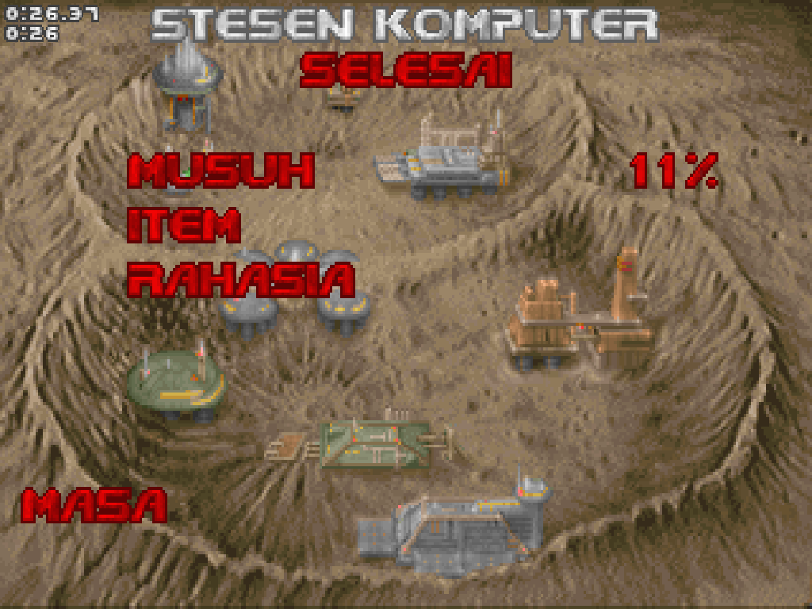

Also dated 12th October 2024. This one showcases the old, misspelled translation of Secret, which should be Rahsia, but instead is Rah**a**sia. Also around this time I blanked out the Total graphic, after deeming the "Jumlah" translation too long, and before setteling back to using the untranslated Total graphic.

---

## Some MalayDoom screenies (Dec 2022)

Originally uploaded as an [imgur album](https://imgur.com/a/G5Fyx8s) back in December 2022 with the following captions:

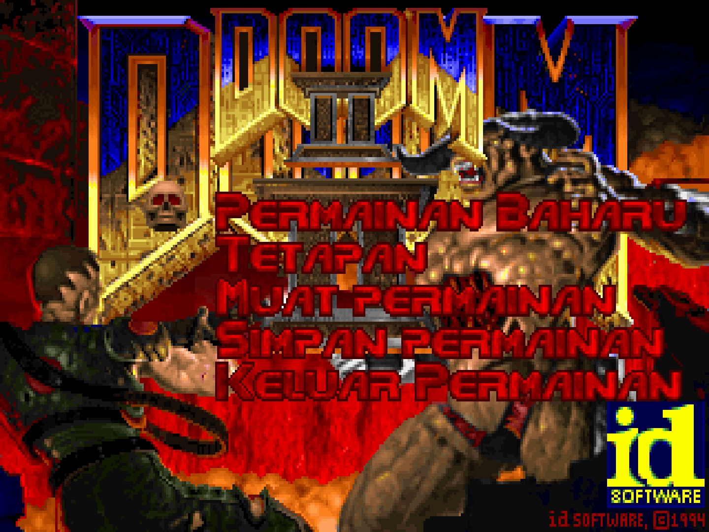

Main/Pause Menu

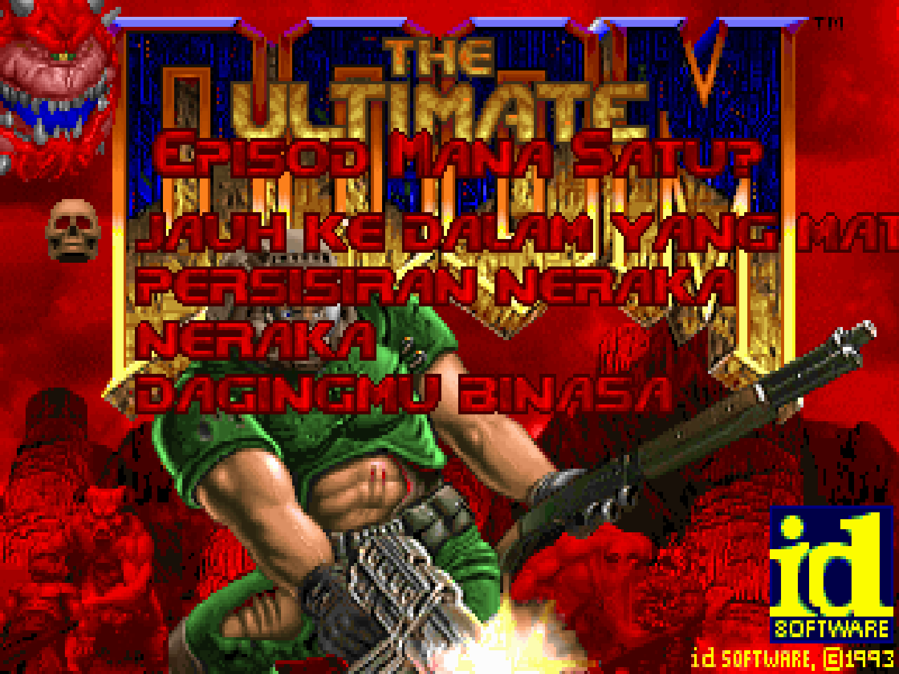

DOOM 1 Episode Selection Screen 
The name for Episode 1 goes out of screen in 4:3

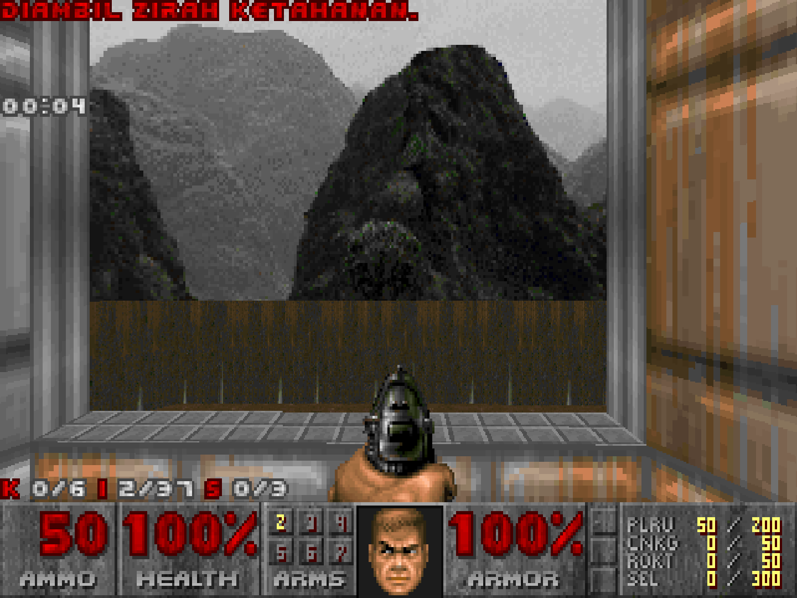

Picking up a green armor!

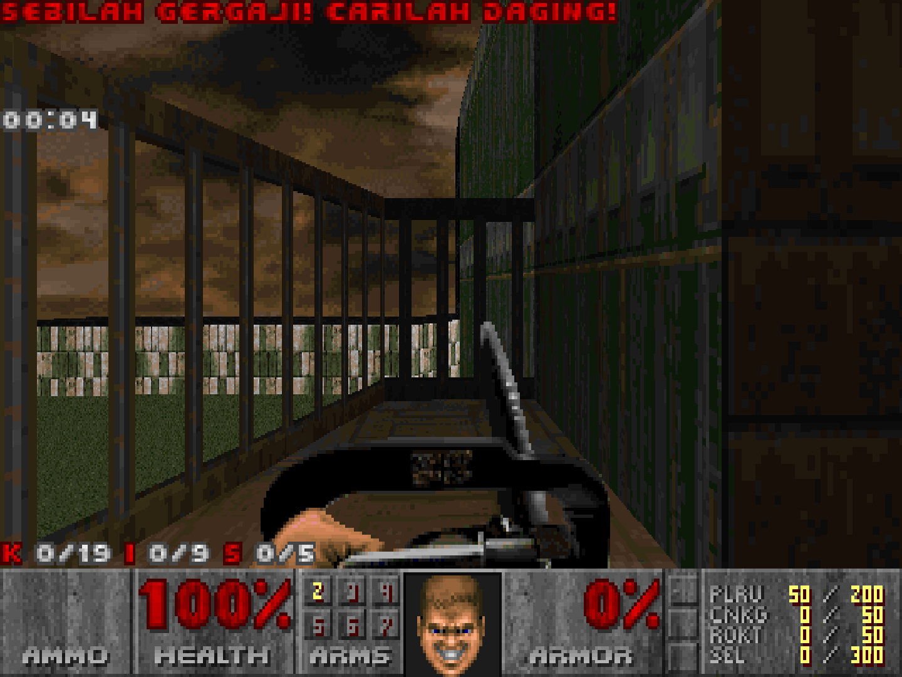

Picking up a chainsaw! Time to find some daging!

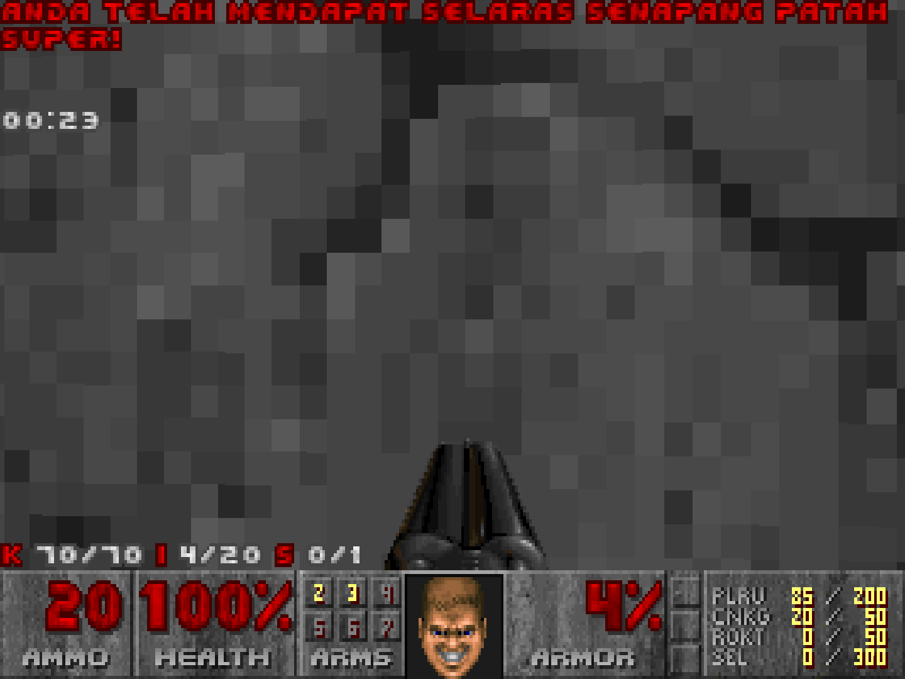

Picking up a super shotgun! The line goes beyond the screen in 4:3, and even in 16:9, so I have to make the pickup message a two line string (and also for the backpack pickup)

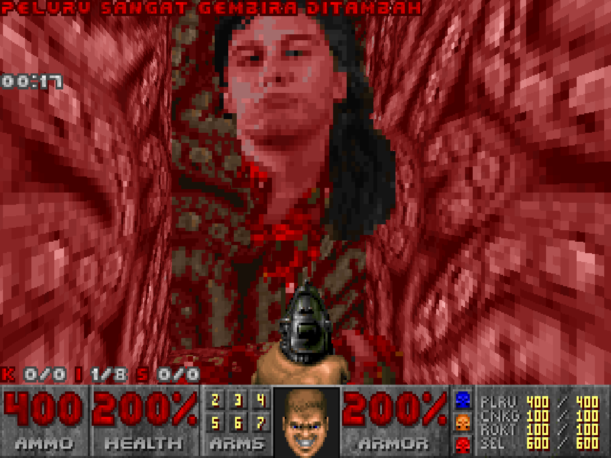

IDKFA Cheat Message 
oh, hi John

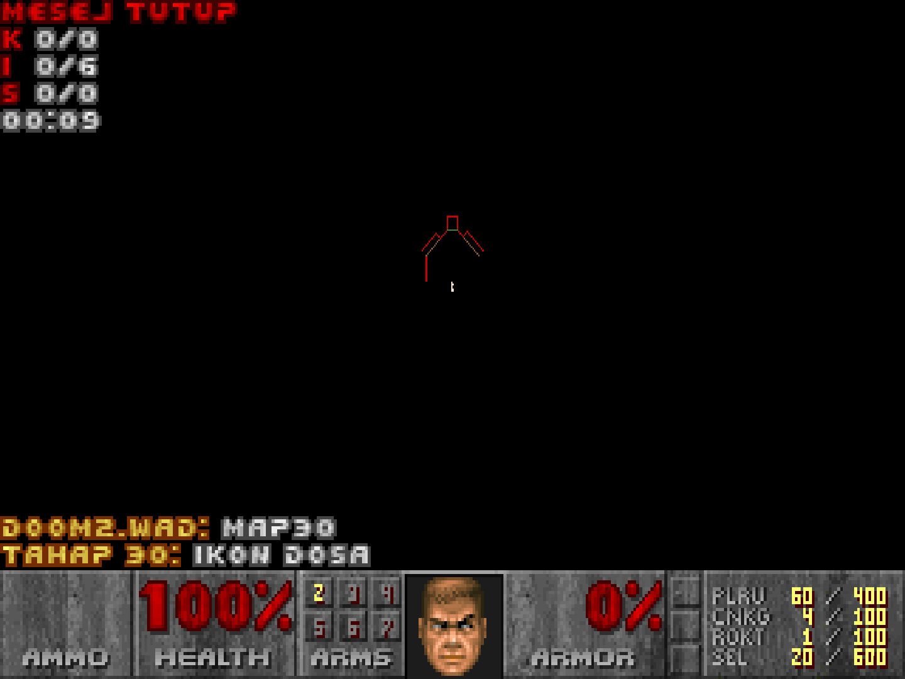

Icon of Sin (automap name) 
Yes I do keep the difference between the name in the intermission screen and in the automap on MAP11

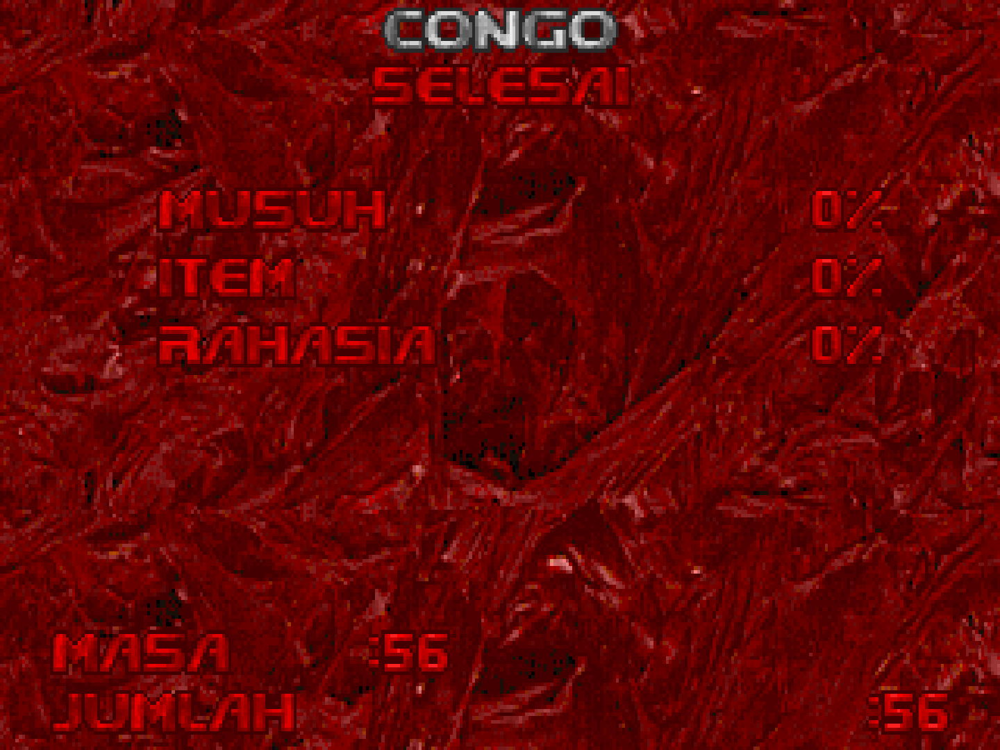

Intermission screen 
The total time gets pushed to the very right of the screen in Crispy Doom, but not on other ports that I tested it in

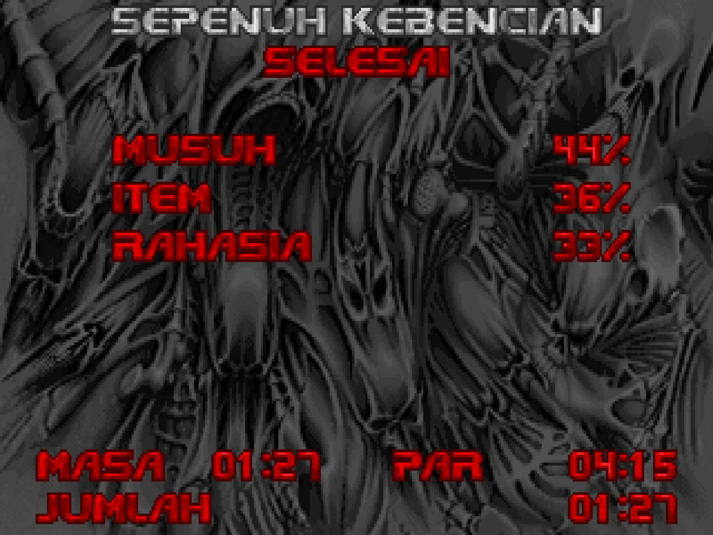

Fun Fact about the level names in Thy Flesh Consumed : 
Just like the original, I searched to the Malay translations of the Bible verses that each of the levels names is based on, and modified it from there

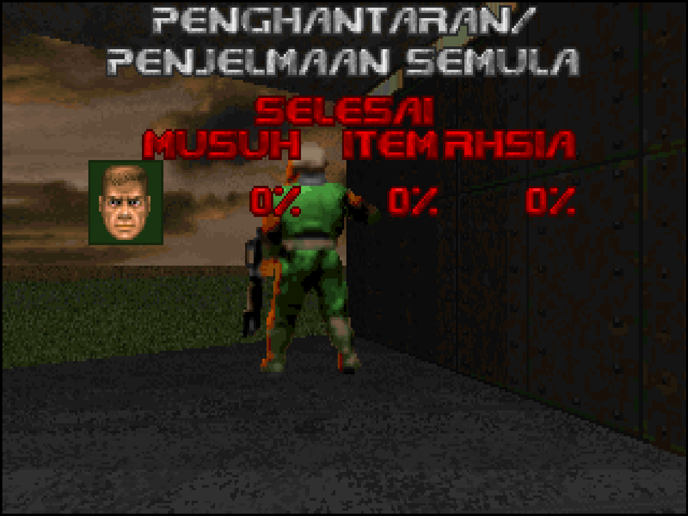

Co-Op (or Solo-Net) Intermission Screen 
The name has to be in two lines to make it fit in 4:3

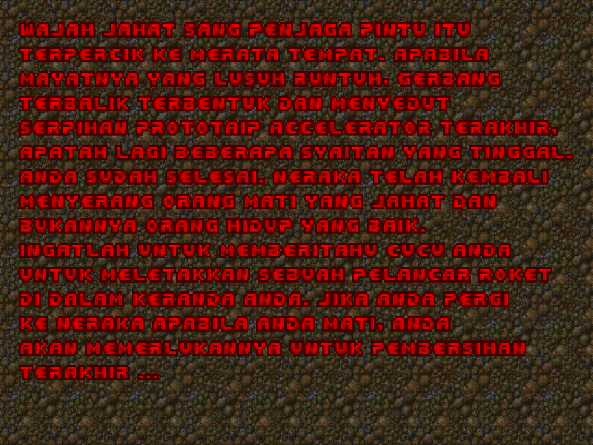

Plutonia MAP30 Text Screen 
(Crispy Doom compatible!)

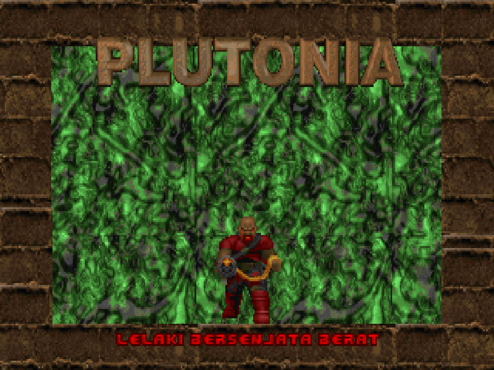

Our favourite Plutonian hitscanner

[Back to the top](#some-malaydoom-screenies-dec-2022)